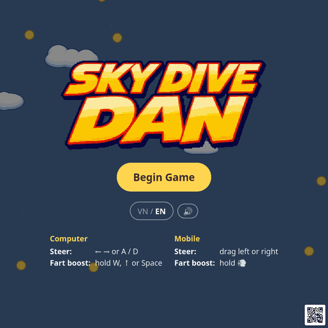

# Sky Dive Dan

Dan jumps out of a plane, pulls the cord, and his backpack launches his lunch instead of a parachute. To stay airborne he bounces from cloud to cloud and grabs coins. He can fart his way out of trouble, but every fart burns coins.

**Play it:** <https://harryr.github.io/skydivedan.web/>. It runs in any modern browser on desktop or mobile, with no install and no account.

<p align="center">
  <a href="https://harryr.github.io/skydivedan.web/"></a>
  &nbsp;
  <a href="https://harryr.github.io/skydivedan.web/"></a>
</p>
<p align="center">Click either image to play, or scan the QR code with your phone.</p>

This is a new browser version of *Sky Dive Dan*, a game I've rebuilt several times since the original V-Cade release. An earlier C++/SDL version is [here](https://gist.github.com/HarryR/5457326).

## How to play

|  | Computer | Mobile |
|---|---|---|
| **Steer** | ← → or A / D | Drag left or right anywhere |
| **Fart boost** | Hold W, ↑ or Space | Hold the 💨 button (drag while holding to steer) |
| **Pause** | Esc or P | ❚❚ button, top right |

- **Bounce:** land on a cloud to bounce back up. Rising up through a cloud bounces you again, so stacked clouds chain you higher.
- **Collect:** coins are your score *and* your fart fuel. Big gold coins are worth 10.
- **Avoid:** spiky mines blow Dan up. So does hitting the ground.
- **Altitude:** higher up, clouds are sparser but bounces are bigger. Lower down it gets dense and frantic.
- **Your best score** (the coins you're holding when the run ends) is saved in your browser.
- **Rainbow trail:** beat your best or go on a coin streak and Dan leaves a rainbow sparkle trail.

On the start, pause and game-over screens, the QR code in the corner links to the game. Tap it to enlarge it so a friend can scan it. The game is in English and Vietnamese (VN / EN toggle) and has synthesized sound effects with a mute toggle.

## Running locally

The game is plain JavaScript ES modules with no build step and no dependencies to install. Serve the folder with any static file server, for example:

```sh
python3 -m http.server
```

Then open <http://localhost:8000>. Add `?debug` to the URL, or press the backtick key in game, to show hitboxes, the simulation window and entity counts.

If a reload looks broken after you pull changes, do a hard refresh (Ctrl+Shift+R). Browsers can cache a mix of old and new module files.

## How it's built

- **Rendering:** Canvas 2D for the world; HTML/CSS for menus and the HUD.
- **Simulation:** a fixed-step 30 Hz simulation drawn every animation frame. Clouds drift along analytic paths from a bounded pool around Dan and are replaced off-screen, so nothing pops into view.
- **Procedural:** clouds, scenery (stars, mountains, trees), the splat and explosion effects, sparkles, the rainbow trail and all sound effects. None of them use image or audio files.
- **Art:** the logos and Dan's body, arm and leg sprites are small crunched 8-bit PNGs, a few KB in total. Dan is rigged from those parts at runtime.

| Path | What's there |
|---|---|
| `src/main.js` | Boot, layout, frame loop |
| `src/game.js` | Game states (start, run, pause, splat, game over), sound and haptic cues |
| `src/simulation.js`, `src/world.js` | Physics, collisions, cloud and pickup spawning |
| `src/render.js` | Drawing; uses `cloudart.js`, `danart.js`, `scenery.js`, `splat.js`, `sparkle.js`, `trail.js` |
| `src/input.js`, `src/ui.js`, `src/i18n.js`, `src/audio.js`, `src/qr.js` | Controls, menus, translations, sound, share QR |
| `src/config.js` | Every tuning value: physics, spawn rates, sizes, colours |
| `tools/crunch.py` | Turns full-size art into small crunched PNGs (Python + Pillow, optional pngcrush) |

The design notes are in [GAME_PLAN.md](GAME_PLAN.md), [SIMULATION_DESIGN.md](SIMULATION_DESIGN.md), [TECHNICAL_IMPLEMENTATION_GUIDE.md](TECHNICAL_IMPLEMENTATION_GUIDE.md) and [art.md](art.md).

The site deploys to GitHub Pages automatically on every push to `main` ([workflow](.github/workflows/pages.yml)).

## Credits

- Game by [HarryR](https://github.com/HarryR).
- The QR codes use [qrcode-generator](https://github.com/kazuhikoarase/qrcode-generator) by Kazuhiko Arase (MIT), vendored in `src/vendor/`. QR Code is a registered trademark of DENSO WAVE INCORPORATED.
